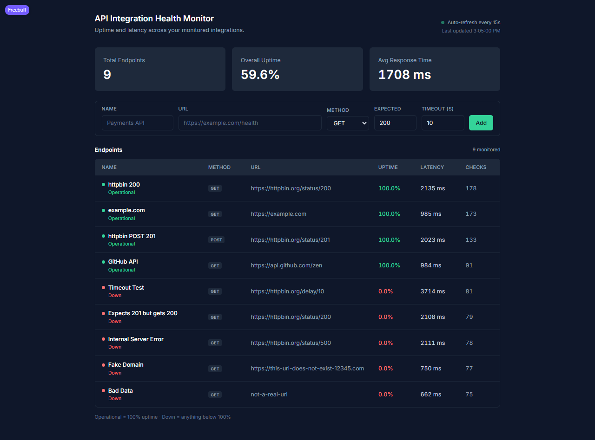

# API Integration Health Monitor



A background monitoring service that continuously checks the health of your API integrations and exposes uptime and latency analytics through a dark-mode dashboard. Built with **Python · FastAPI · SQLite (SQLAlchemy async) · httpx · React (CDN)** — no Node.js build step required.

## Problem Statement

Modern applications are assembled from third-party APIs — payments, auth, data providers, internal services. When one of them degrades, the failure rarely announces itself: requests time out, error rates climb, latency creeps up, and users notice long before any dashboard does.

Without proactive monitoring, teams find out from customers instead of from their own tooling, and they have no historical record to answer "when did this start?" or "how often does it really fail?". This project provides that missing layer: a lightweight service that runs in the background, probes each configured endpoint on a fixed interval, persists every observation, and turns the raw history into the two numbers that matter — **uptime** and **latency** — so integration health is visible at a glance rather than discovered during an incident.

## Features

- **Dark-mode dashboard** — a flat, professional UI (Inter font, slate/emerald palette) served statically by FastAPI: summary metric cards, per-endpoint status indicators (`Operational` / `Down`), and a live endpoint table.
- **Background polling** — an asyncio task in the FastAPI lifespan checks every registered endpoint every 15 seconds using `httpx.AsyncClient` and writes a `HealthCheck` row per result; the UI polls the same API every 15 seconds to stay current.
- **SQLite metrics aggregation** — `GET /endpoints/{id}/metrics` aggregates check history into `total_checks`, `successful_checks`, `uptime_percentage` and `avg_response_time_ms` (NULL latencies are excluded from the average), computed in SQL and served as Pydantic models.
- **Configurable checks** — each endpoint stores its own HTTP method (`GET`/`POST`/`PUT`/`DELETE`), expected status code, and timeout in seconds, so a slow service and a strict status contract are both modelled accurately.
- **Simple REST API** — register endpoints with `POST /endpoints`, list them with `GET /endpoints`, and browse interactive OpenAPI docs at `/docs`.

## How to Run

Requirements: Python 3.11+ (tested on 3.14).

```bash
# 1. Install dependencies
pip install -r requirements.txt

# 2. Start the service
uvicorn app.main:app --host 127.0.0.1 --port 8000

# 3. Open the dashboard
#    http://127.0.0.1:8000/          → dashboard
#    http://127.0.0.1:8000/docs      → interactive API docs
```

Tables are created automatically on startup in `monitor.db`, so there is no migration step. Add your first endpoint from the form on the dashboard — it will be checked on the next 15-second cycle.

## Testing

```bash
python -m pytest tests/ -v
```

The suite covers the metrics endpoint end to end: an endpoint with 3 successful and 1 failed check must report exactly **75.0%** uptime with the correct average latency, plus the edge cases — `NULL` response times ignored in the average, zero checks returning all zeros, and unknown endpoints returning `404`. Tests run against their own `test_monitor.db` (selected via the `DATABASE_URL` environment variable) and clean up afterwards, so they never touch real monitoring data.

## Project Structure

```
app/
  main.py              # FastAPI app, lifespan (table creation + 15s monitor loop), static mount
  database.py          # async SQLite engine, session factory, get_db dependency
  models.py            # Endpoint and HealthCheck ORM models
  schemas.py           # EndpointCreate / EndpointResponse / EndpointMetrics / EndpointCheckResponse
  routers/endpoints.py # POST /endpoints, GET /endpoints, GET /endpoints/{id}/metrics
  services/monitor.py  # check_endpoint() — httpx request with timing and failure handling
  static/index.html    # React (CDN) single-page dashboard
tests/
  test_metrics.py      # uptime / latency analytics tests
requirements.txt
dashboard-screenshot.png
```
